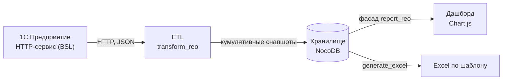

# Analytics Demo — дашборд исполнения строительных договоров

Демонстрационная версия аналитического портала для управления портфелем
строительных договоров подряда: движение денег (авансы, оплата работ, цессии,
удержания по банковским гарантиям), закрытие авансов, реализация и процент
исполнения — по каждому объекту, договору и портфелю в целом, на любую дату.

> **Это демо:** все данные синтетические (сгенерированы скриптом), названия
> компаний, договоров и объектов вымышленные. Сервер работает автономно —
> ни 1С, ни база данных не нужны.

## Быстрый старт

**Windows:** двойной клик по `start_demo.bat` — сам найдёт Python, при первом
запуске поставит openpyxl, поднимет сервер и откроет браузер.

**Вручную (Windows/Linux/Mac):**

```bash
pip install openpyxl
python demo_server.py
# открыть http://127.0.0.1:8000
```

Логины (пароль у всех `Demo1234!`):

| Логин | Роль | Что видит |
|---|---|---|
| `admin@demo.ru` | admin | всё + панель пользователей + редактор стоимостей |
| `buh@demo.ru` | accounting | всё + редактор стоимостей |
| `manager@demo.ru` | management | дашборд (только просмотр) |

## Что умеет дашборд

- **KPI-карточки** по выбранному узлу: стоимость договоров, сдано работ,
  «Получено оплат» с расшифровкой (аванс деньгами / оплата работ / цессии /
  удержание по БГ), незакрытый остаток авансов, доля выполнения.
- **Drill-down дерево** Портфель → Площадка → Договор → Объект: клик по строке
  пересчитывает все карточки и графики.
- **4 графика:** динамика выполнения по объектам, структура полученных оплат,
  остаток незакрытых авансов (группировка по договорам), доля выполнения.
- **Отчёт на произвольную дату:** история снапшотов с конца 2023 года;
  датапикер с календарём; Excel-выгрузка на отдельную дату по тому же шаблону,
  что в проде. Скачанный Excel открывает в «Защищённом просмотре»
  (стандартная реакция на файлы из интернета) — нажмите **«Разрешить
  редактирование»**, и таблица заполнится полностью (формулы пересчитаются).
- **Флаг «объект завершён»:** объект сдан, но стоимость договора выбрана не
  полностью (остаток ждёт доп. соглашения) — вместо процента показывается
  «✓ завершён», на графике — столбец 100%.
- **Разграничение прав** по ролям (проверка на сервере), сессии с TTL,
  автоматический разлогин после часа неактивности.

## Зачем этот проект (экономическое обоснование)

Подрядчик ведёт несколько параллельных договоров с заказчиком-девелопером.
Бухгалтерия видит учёт в 1С, но ответы на управленческие вопросы — «сколько
нам заплатили по каждому объекту и как», «сколько авансов не закрыто сдачей
работ», «какой процент договора исполнен», «как это менялось по месяцам» —
из стандартных ОСВ не извлекаются: проводки разнородные, авансы закрываются
непропорционально, часть оплат приходит цессиями и зачётами в удержания по
банковским гарантиям.

Портал решает это автоматизацией полного цикла:

1. **1С → портал.** HTTP-сервис внутри 1С отдаёт построчные учётные записи
   (платежи, зачёты, реализации) с классификацией; ETL-скрипт маппит их на
   объекты через справочник номенклатурных групп и собирает кумулятивные
   снапшоты на дату.
2. **Хранилище и API.** Снапшоты и справочники (стоимости договоров, лимиты
   авансов — этих данных в 1С нет) складываются в NocoDB; фасад отдаёт
   дашборду готовые агрегаты.
3. **Дашборд.** Руководство и бухгалтерия смотрят портфель целиком или
   drill-down до объекта, на любую дату, с выгрузкой в Excel по тому же
   шаблону, что использовался вручную.

Эффект: ручная Excel-таблица, которую бухгалтерия заполняла и сверяла вручную
(и в которой накапливались ошибки), заменена автоматическим отчётом с полной
историей и drill-down; сверка с бухгалтерской ОСВ — в ноль расхождений.

## Архитектура



В демо-версии слой 1С/NocoDB/n8n заменён файлом синтетических событий и
`demo_server.py`, но **агрегация, логика дашборда и заполнение Excel — те же
модули, что в проде** (`scripts/transform_reo_v1.0.py`, `report_reo.py`,
`generate_excel_reo_v1.0.py`): демо показывает рабочую логику, а не имитацию.

## Структура

| Путь | Назначение |
|---|---|
| `demo_server.py` | Автономный сервер: статика, auth, данные дашборда, Excel |
| `data/demo_records.json` | Синтетические учётные события (формат выгрузки 1С) |
| `data/demo_terms.json` | Справочник: стоимости договоров, лимиты авансов, флаги |
| `index.html` | Дашборд (vanilla JS + Chart.js, без сборки) |
| `template.xlsx` | Шаблон Excel-отчёта (структурные формулы) |
| `1c/` | Модули HTTP-сервиса 1С (BSL) — продовая интеграция |
| `scripts/` | Продовый конвейер: ETL, генерация Excel, фасад, авторизация |

## Технологии

Python 3 (stdlib + openpyxl), vanilla JavaScript + Chart.js, 1С:Предприятие
(BSL, HTTP-сервис). В проде дополнительно: NocoDB, n8n, Docker, systemd.

## Учётные допущения (на что смотреть)

- Отбор проводок — по договору подряда в субконто (не по счетам).
- Классификация: 51/52 → аванс/оплата работ, 76.09 → цессия, 62↔62 → закрытие
  аванса, 62→90.01 → реализация, цессии по договорам обеспечения → удержание
  по БГ (учитывается на объекте-источнике оплат).
- Аванс 2023 года входит в отчёт (выгрузка запрашивается с даты начала
  договоров, а не с начала года).
- Корректировки дебиторки (91.02→62.0x) учитываются как оплата выполненных
  работ — по решению экономиста (деньги не приходили, но задолженность
  погашена).
